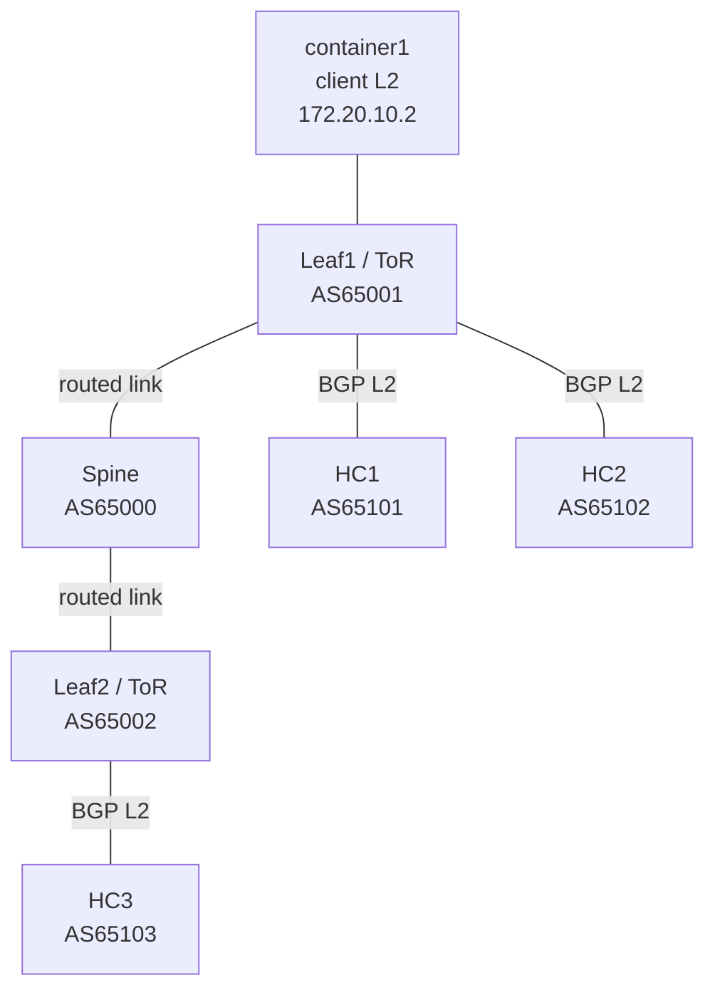

# Turnkey Neutron OVN BGP lab on local LXD

This Terraform project creates and deploys an isolated Ubuntu 26.04 LXD lab.
One `terraform apply` builds the routed spine/leaf network, installs and
bootstraps regress-stack on three hyperconverged VMs, configures Neutron's
native OVN BGP plugin and agent, creates three overlay VMs with floating IPs,
and verifies pings from a client container on a separate L2.

The lab uses a prebuilt regress-stack package with the inventory-driven
three-node hyperconverged profile and private preseed workflow. The verified
package was built from [PR 96](https://github.com/canonical/regress-stack/pull/96)
revision `a37016f35b4fc67701a9c9edee44baa500c33d99` plus
[`patches/local-provider-bridge.patch`](patches/local-provider-bridge.patch).
The archive's regress-stack 0.2 package lacks that multinode CLI. The lab
never builds software during deployment; OpenStack services use Ubuntu
archive packages.



Leaf1 is the ToR for HC1 and HC2; Leaf2 is the ToR for HC3. There is no ToR
above the spine. On each HC, `enp5s0` is the routed BGP link on `br-bgp`,
`enp6s0` is management. Each HC has a local `br-interconnect` OVS bridge
mapped as `physnet1:br-interconnect`, with no physical uplink or shared
provider L2. It forwards packets between OVN patch ports; the physical
ToR uplink is `enp5s0` on `br-bgp`. Container1 reaches the FIP subnet through
Leaf1 and has no L2 attachment to the HC networks.

| Nodes | LXD type | CPU / RAM each |
|---|---|---:|
| HC1, HC2, HC3 | VM | 4 / 10 GB |
| Leaf1, Leaf2, Spine | container | 1 / 512 MiB |
| container1 | container | 1 / 256 MiB |

## Requirements

- A local LXD server and CLI, with the CLI default remote pointing to the same
  server as the Terraform provider (`lxc info` should work).
- Terraform 1.6 or newer, internet access from the host and guests, and an
  LXD storage pool named `default` (or override `storage_pool`).
- Sufficient capacity for three 4-vCPU/10-GB guests plus the containers.
  Nested KVM is enabled by LXD; Nova workload launch inside the HCs is not part
  of the BGP acceptance test.

The lab uses Resolute packages and pins Neutron to
`2:28.0.2-0ubuntu1` from `resolute-updates`. No proposed pocket is enabled.
Provide the prebuilt `python3-regress-stack` package separately, then set its
path in `terraform.tfvars`:

```hcl
regress_stack_package = "/absolute/path/python3-regress-stack_0.3.0_all.deb"
```

The supplied package must support the multinode CLI and the inventory's
local `br-interconnect` without a provider interface. The tracked patch
records the change used by the verified package. Terraform tracks the
package checksum and the deployer installs the same file on all HCs. It
does not fetch source, build a package, or rerun its build tests.

## Deploy

Run from this directory on a fresh LXD project/server:

```sh
terraform init
terraform validate
terraform plan -out=lab.tfplan
terraform apply lab.tfplan
```

Terraform waits for cloud-init, runs [`deploy.sh`](deploy.sh), and returns
success only after the BGP routes reach both leaves and the spine and
container1 gets three successful pings. No SSH key is needed; the harness
uses the local LXD API and `lxc exec`. Generated preseeds exist briefly in a
mode-0700 host temp directory during transfer, are mode 0600, and are deleted
when the apply completes. Other regress-stack credentials remain inside the
HC guests and are not stored in Terraform state.

Terraform tracks resources with the `nbgp` prefix by default. If that prefix
already exists on your LXD server, choose a free short prefix (for example,
`-var=name_prefix=nbgp2`; keep LXD bridge names at 15 characters or fewer).
Use a separate Terraform working directory/state for a parallel deployment.
The old `bgpe-*` resources are unrelated and are not touched.

The last deployed manual lab is already running under the default `nbgp`
names. This updated automation has not been applied to it: its existing
Terraform state can show in-place cloud-init/interface changes. Use a fresh
checkout/state for a clean automated deployment, or inspect the plan before
applying any changes to that existing lab. Do not apply a plan that shows
resources you do not intend to change. `terraform destroy` removes only the
LXD resources in that working directory; the OpenStack objects live on those
VM disks and disappear with them.

## Choose chassis-to-ToR peering

Set `bgp_peering_mode` in `terraform.tfvars` so subsequent applies retain
that choice:

```hcl
bgp_peering_mode = "ipv4-numbered"
```

The default, `"unnumbered"`, retains IPv6 link-local BGP transport and
extended next hops for IPv4 routes. `"ipv4-numbered"` uses IPv4 transport
and IPv4 next hops only for the chassis-to-ToR sessions; the spine links,
ASNs, provider network, and workload addressing stay the same.

| Link | Chassis address on `br-bgp` | ToR address on `eth1` |
|---|---|---|
| HC1 → Leaf1 | `172.20.1.11/24` | `172.20.1.1/24` |
| HC2 → Leaf1 | `172.20.1.12/24` | `172.20.1.1/24` |
| HC3 → Leaf2 | `172.20.2.13/24` | `172.20.2.1/24` |

Run `terraform plan -out=lab.tfplan`, review it, then
`terraform apply lab.tfplan`. Changing the mode **replaces all seven lab
instances**, including their OpenStack state and any locally installed fix.
The LXD networks remain when switching modes. Applying the local-interconnect
commit to an older lab also replaces all guests and removes its provider
network. This is deliberate: cloud-init templates do not
reconfigure existing guests on an in-place update. In-place switching is
not implemented. To switch back, set the variable to `"unnumbered"` and
plan/apply again.

Numbered mode is a reproducer for Neutron's numbered BGP integration and
for testing a fix; it does not include that fix. The deployer still requires
BGP sessions, table 42 FIP routes, table 10 return routes via the selected
ToR address, fabric propagation, and client pings. An unfixed Neutron may
therefore fail the apply. Guests remain available for inspecting and
installing a fix; re-run `terraform apply` after correcting the failure.
The deployer retains its pinned Neutron package check on retries, so use a
matching version when installing a rebuilt package or override
`neutron_package_version` when deploying a different published version.

Local configuration checks (Terraform >= 1.7 for provider mocks):

```sh
terraform fmt -check
terraform validate
terraform test -var=bgp_peering_mode=unnumbered
python3 -m unittest discover -s tests
bash -n deploy.sh
shellcheck deploy.sh
```

The Terraform tests render both modes with a mocked LXD provider and do
not create guests or exercise Neutron. Live acceptance remains the
route and ping checks in `deploy.sh` against a deployed lab.

## What apply configures

1. Terraform creates the six isolated LXD bridges and seven instances.
   Only management has NAT. Leaf1/Leaf2/Spine run BIRD; the three HCs stage
   their BIRD templates but keep BIRD stopped until the OVN BGP agent is ready.
2. The harness installs the supplied regress-stack package and each
   inventory role's Ubuntu package list, then bootstraps
   HC1 and joins HC2/HC3 with private preseeds. It waits for `regress-stack
   ready`.
3. It enables Neutron's `ovn-bgp` service plugin with main-router table 42 and
   chassis table 10. It creates a persistent `br-bgp` unit, configures the
   OVN BGP agent systemd unit and extension, runs the Neutron DB migration,
   and starts the agent and BIRD. The agent reconciles BGP metadata,
   `dynamic-routing-port-mapping`, patch ports, and local OpenFlow. The
   local interconnect is mapped as `physnet1:br-interconnect`; it has no
   physical provider NIC.
4. It creates flat external network `external-network` on `physnet1`, subnet
   `172.20.20.0/24`, overlay `bgp-overlay` (`10.244.0.0/24`), a router, and
   three Cirros guests pinned one per HC, each with a fixed floating IP.
5. It enables DHCP on the isolated external subnet and restarts
   `neutron-periodic-workers` to resync BGP topology. This supplies the OVN
   `DHCP_Options` router value used by the Neutron plugin when it creates the
   BGP interconnect router port. This records the behavior required by this
   lab implementation; it does not claim production physnets generally need
   DHCP.
6. It verifies all three FIP `/32`s on Leaf1, Leaf2, and the Spine, then pings
   all FIPs from container1. Any failed stage makes `terraform apply` fail.

The test floating IPs and instances are:

| Instance | HC | Overlay IP | FIP |
|---|---|---:|---:|
| `bgp-test-hc1` | HC1 | `10.244.0.67` | `172.20.20.69` |
| `bgp-test-hc2` | HC2 | `10.244.0.178` | `172.20.20.26` |
| `bgp-test-vm` | HC3 | `10.244.0.110` | `172.20.20.60` |

Cirros 0.6.3 is downloaded from its upstream release directory and checked
against its published SHA256 before upload. The test guests run headless:
SPICE is disabled because Resolute's QEMU does not support it. The deployer
installs Ubuntu's `qemu-block-extra` package so QEMU can open the configured
Ceph RBD disks. The lab allows ICMP ingress to
these test guests only.

## Inspect and troubleshoot

After apply, useful checks include:

```sh
lxc exec nbgp-container1 -- ping -c 3 172.20.20.69
lxc exec nbgp-hc1 -- ip -4 route show table 42
lxc exec nbgp-hc1 -- ip -4 route show table 10
lxc exec nbgp-hc1 -- birdc show route
lxc exec nbgp-hc1 -- sudo ovn-sbctl list Learned_Route
lxc exec nbgp-hc1 -- sudo ovs-vsctl get Open_vSwitch . external-ids:dynamic-routing-port-mapping
lxc exec nbgp-hc1 -- sudo ovs-ofctl -O OpenFlow13 dump-flows br-bgp
lxc exec nbgp-leaf1 -- birdc show route
lxc exec nbgp-leaf2 -- birdc show route
lxc exec nbgp-spine -- birdc show route
```

On failure, Terraform keeps the LXD instances for diagnosis. Re-run
`terraform apply` to retry the setup after correcting the issue; regress-stack
setup uses local checkpoints and the harness recreates named OpenStack
resources idempotently. Inspect guest service logs with:

```sh
lxc exec nbgp-hc1 -- sudo journalctl -u neutron-ovn-agent -b --no-pager
lxc exec nbgp-hc1 -- sudo journalctl -u neutron-periodic-workers -b --no-pager
lxc exec nbgp-hc1 -- sudo birdc show protocols all
```

## Verification status and limits

The live manual deployment passed `regress-stack ready`, had active BIRD and
Neutron OVN BGP agent services on all HCs, advertised the three FIP `/32`s to
the fabric, and returned three pings from container1 with zero packet loss.
I also built the pinned PR 96 Debian package in a disposable Resolute
container; `dpkg-buildpackage` passed 166 tests with one skip. Terraform
validation, the deployment shell syntax, and ShellCheck pass. A clean
end-to-end run of this new `terraform apply` harness is still required before
claiming turnkey integration verified; the current LXD host had only about
15 GiB available, so I did not launch another three 10-GB VMs alongside the
working lab.

This is a BGP reachability test. It does not test route withdrawal/failover,
scale, Octavia, or Nova launching nested guests. For regress-stack details,
see the [multinode guide](../../docs/multinode.md) and [PR 96](https://github.com/canonical/regress-stack/pull/96).
