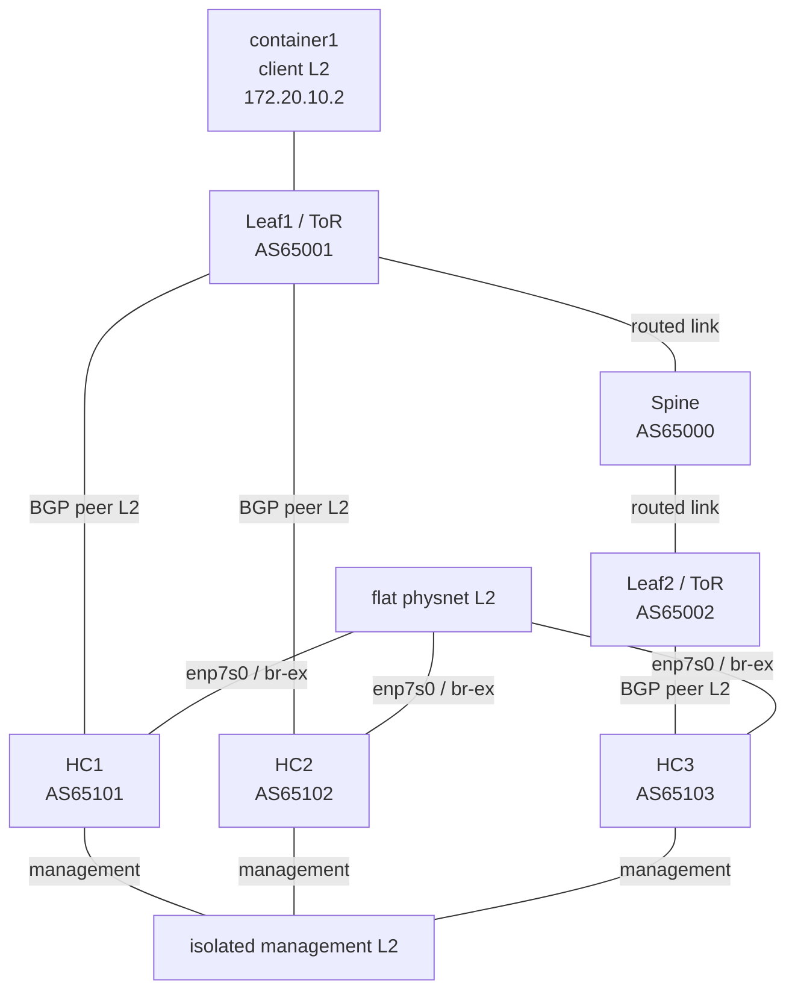

# Neutron native OVN BGP on local LXD

This directory contains an isolated Terraform LXD topology and the exact
configuration used to validate Neutron's native OVN BGP path with three
hyperconverged nodes on Ubuntu 26.04 (Resolute). Leaf1 is the ToR for HC1/HC2;
Leaf2 is the ToR for HC3. The spine connects the two leaves; there is no ToR
above the spine.



The HC BGP NIC (`enp5s0`) is attached to `br-bgp`; the provider NIC
(`enp7s0`) is attached to `br-ex`; management is `enp6s0`. Thus the simulated
fabric traffic enters through `br-bgp`, while the external provider network
is represented separately on `br-ex`. Container1 has no L2 attachment to
the provider/HC networks; it routes the provider subnet through Leaf1.

| Nodes | LXD type | CPU / RAM each | Links |
|---|---|---:|---|
| HC1, HC2, HC3 | VM | 4 / 10 GB | management, BGP, provider |
| Leaf1, Leaf2, Spine | container | 1 / 512 MiB | management and fabric |
| container1 | container | 1 / 256 MiB | management and client |

Terraform creates seven isolated bridges. Only management has NAT. Resource
names start with `nbgp`; the earlier `bgpe-*` experiment is separate and left
untouched. The VMs expose `/dev/kvm`, but nested guest-launch support needs a
separate Nova workload test.

## Create the topology

For a fresh deployment, run from this directory against the local LXD socket:

```sh
terraform init
terraform validate
terraform plan -out=lab.tfplan
terraform apply lab.tfplan
```

`inventory.json` matches the HC hostnames and NIC contract. SSH is optional;
to enable it, create `terraform.tfvars` with your public key:

```hcl
ssh_public_key = "ssh-ed25519 AAAA..."
```

Otherwise, use `lxc exec nbgp-hc1 -- ...`. Review every plan before applying.
After manual setup, a plan may propose in-place cloud-init/interface changes;
do not apply those to the live deployment without reviewing their effects.
`terraform destroy` targets resources declared here only.

## Install and bootstrap regress-stack

Terraform does not install the current regress-stack source or run OpenStack
setup. Build/install regress-stack from the desired branch on all three HCs.
The source revision used in the verified deployment was
`70ef494402910e8b7fb60dab6857e4b9f4f8e11f`. Copy `inventory.json` to
`/root/inventory.json` on each HC and install each node's package requirements:

```sh
sudo regress-stack packages --inventory /root/inventory.json --node "$(hostname --short)"
```

Install the reported packages. Bootstrap HC1 first and export private
preseeds:

```sh
sudo regress-stack setup --inventory /root/inventory.json --node nbgp-hc1 \
  --export-preseeds /root/regress-preseeds
```

Securely transfer HC2/HC3 preseeds to those nodes (mode 0600), then run
`sudo regress-stack setup --preseed /root/nbgp-hcN.json` on each respective
HC. Keep preseeds and generated credentials private and outside this
Terraform directory. Finish with `sudo regress-stack ready` on HC1. That
check passed in the deployed lab; workload acceptance is checked separately.
See the [multinode guide](../../docs/multinode.md) for full bootstrap details.

## Configure Neutron and the BGP agent

The verified deployment used Neutron `2:28.0.2-0ubuntu1` from
`resolute-proposed`. Archive candidates change, so check before a new run:

```sh
apt-cache policy neutron-server
```

On all three HCs, edit `/etc/neutron/neutron.conf`: add `ovn-bgp` to the
existing `service_plugins` list and configure:

```ini
[bgp]
main_router_vrf_id = 42
chassis_router_vrf_id = 10
```

Run the database migration once, from HC1, then restart the Neutron
server-side services on every HC:

```sh
sudo neutron-db-manage --config-file /etc/neutron/neutron.conf \
  --config-file /etc/neutron/plugins/ml2/ml2_conf.ini upgrade head
sudo systemctl restart apache2 neutron-rpc-server neutron-periodic-workers
```

The package provided `/usr/bin/neutron-ovn-agent` but no systemd unit. On
each HC, create `/etc/neutron/plugins/ml2/ovn_agent.ini`:

```ini
[agent]
extensions = ovn-bgp

[ovs]
ovsdb_connection = unix:/var/run/openvswitch/db.sock
```

Set ownership to `root:neutron`, mode `0640`. Create
`/etc/systemd/system/neutron-ovn-agent.service`:

```ini
[Unit]
Description=Neutron OVN Agent with BGP extension
After=network-online.target openvswitch-switch.service ovn-controller.service
Wants=network-online.target ovn-controller.service
Requires=openvswitch-switch.service

[Service]
Type=simple
User=root
Group=root
ExecStart=/usr/bin/neutron-ovn-agent --config-file=/etc/neutron/neutron.conf --config-file=/etc/neutron/plugins/ml2/ml2_conf.ini --config-file=/etc/neutron/plugins/ml2/ovn_agent.ini
Restart=on-failure
RestartSec=2

[Install]
WantedBy=multi-user.target
```

On each HC, attach the BGP interface to an OVS bridge and set its link-local
address. Preserve the NIC's existing MAC when creating the bridge. The
addresses are HC1 `fe80::101/64`, HC2 `fe80::102/64`, HC3 `fe80::103/64`:

```sh
sudo ovs-vsctl --may-exist add-br br-bgp
sudo ovs-vsctl --may-exist add-port br-bgp enp5s0
sudo ip link set enp5s0 up
sudo ip link set br-bgp up
sudo ip -6 addr add fe80::101/64 dev br-bgp
sudo ovs-vsctl set Open_vSwitch . external-ids:neutron-bgp-peer-bridges=br-bgp
sudo systemctl daemon-reload
sudo systemctl enable --now neutron-ovn-agent
```

Use the corresponding link-local address on each HC. Wait for the agent to
reconcile before starting BIRD. Check:

```sh
sudo systemctl status neutron-ovn-agent --no-pager
sudo ovs-vsctl get Open_vSwitch . external-ids:ovn-bridge-mappings
sudo ovs-vsctl get Open_vSwitch . external-ids:dynamic-routing-port-mapping
sudo ovs-vsctl list-ports br-bgp
sudo ovs-ofctl -O OpenFlow13 dump-flows br-bgp
```

The expected mapping includes `br-bgp:br-bgp` and `physnet1:br-ex`; the
physnet device stays on `br-ex`. The OVN agent owns peer-bridge mapping,
dynamic-routing mapping, chassis metadata, patch-port and local OpenFlow
reconciliation. The HC BIRD template is staged by cloud-init at
`/etc/bird/bird.conf`; the HCs have BIRD disabled initially. Start it after
the agent has created/reconciled `br-bgp` and its patch port:

```sh
sudo bird -p -c /etc/bird/bird.conf
sudo systemctl enable --now bird
```

The table IDs must agree with Neutron: table 42 carries OVN-advertised FIP
routes; table 10 is the chassis VRF used for routes learned from BGP.

## Create the provider network and test workload

From HC1, load the regress-stack admin credentials (`/root/auth.rc` in the
deployed lab) and create the flat external network. The node-side bridge
mapping must include `physnet1:br-ex`:

```sh
set -a
. /root/auth.rc
set +a
openstack network create --external --share \
  --provider-network-type flat --provider-physical-network physnet1 \
  external-network
openstack subnet create --network external-network --subnet-range 172.20.20.0/24 \
  --gateway 172.20.20.1 --allocation-pool start=172.20.20.20,end=172.20.20.80 \
  --dhcp external-subnet
```

DHCP is enabled on this isolated test subnet so OVN publishes a
`DHCP_Options` `router` value. The Neutron BGP plugin reads that OVN value
when creating its interconnect logical router port. This is the observed lab
dependency, not a statement that production provider networks generally
require DHCP. If the subnet was first created without DHCP, enable it and
restart `neutron-periodic-workers` on all HCs to trigger a BGP topology
resync:

```sh
openstack subnet set --dhcp external-subnet
sudo systemctl restart neutron-periodic-workers
```

Create an overlay network, subnet, and router, then connect the router to the
external network:

```sh
openstack network create bgp-overlay
openstack subnet create --network bgp-overlay --subnet-range 10.244.0.0/24 \
  bgp-overlay-subnet
openstack router create bgp-test-router
openstack router set --external-gateway external-network bgp-test-router
openstack router add subnet bgp-test-router bgp-overlay-subnet
```

Upload Cirros 0.6.3 as `cirros-0.6.3`, create a small flavor, and allow ICMP
in the test project's default security group:

```sh
openstack image create cirros-0.6.3 --disk-format qcow2 \
  --container-format bare --file /root/cirros.img --public
openstack flavor create bgp-test --vcpus 1 --ram 512 --disk 1
openstack security group rule create --ingress --ethertype IPv4 \
  --protocol icmp default
```

Boot one instance pinned to each hypervisor (these availability-zone host
names match the inventory), then allocate and attach an external floating IP
to each:

```sh
openstack server create --flavor bgp-test --image cirros-0.6.3 \
  --network bgp-overlay --availability-zone nova:nbgp-hc1 bgp-test-hc1
openstack server create --flavor bgp-test --image cirros-0.6.3 \
  --network bgp-overlay --availability-zone nova:nbgp-hc2 bgp-test-hc2
openstack server create --flavor bgp-test --image cirros-0.6.3 \
  --network bgp-overlay --availability-zone nova:nbgp-hc3 bgp-test-vm
openstack floating ip create external-network
openstack server add floating ip bgp-test-hc1 <HC1-FIP>
openstack floating ip create external-network
openstack server add floating ip bgp-test-hc2 <HC2-FIP>
openstack floating ip create external-network
openstack server add floating ip bgp-test-vm <HC3-FIP>
```

The verified run had this placement and these returned FIPs:

| Instance | HC | Overlay IP | FIP |
|---|---|---:|---:|
| `bgp-test-hc1` | HC1 | `10.244.0.67` | `172.20.20.69` |
| `bgp-test-hc2` | HC2 | `10.244.0.178` | `172.20.20.26` |
| `bgp-test-vm` | HC3 | `10.244.0.110` | `172.20.20.60` |

Container1 has a static route for `172.20.20.0/24` via Leaf1
(`172.20.10.1`). Test from the separate L2, replacing the addresses if the
pool assigned different FIPs:

```sh
lxc exec nbgp-container1 -- ping -c 3 172.20.20.69
lxc exec nbgp-container1 -- ping -c 3 172.20.20.26
lxc exec nbgp-container1 -- ping -c 3 172.20.20.60
```

All three pings passed with zero packet loss in the running deployment. This
validates end-to-end FIP reachability for one guest per HC through the
simulated routed fabric. It does not test failover, route withdrawal, scale,
or Octavia.

## Diagnostics

On an HC, inspect FIP routes in table 42, BIRD's route view, upstream routes
in table 10, Neutron's learned routes and router topology:

```sh
ip -4 route show table 42
birdc show route
ip -4 route show table 10
sudo ovn-sbctl list Learned_Route
sudo ovn-nbctl lr-route-list bgp-lr-main
sudo ovn-nbctl lr-policy-list bgp-lr-main
```

Run `birdc show route` on Leaf1, Leaf2, and Spine to confirm the FIP `/32`s.
The observed paths were HC1/HC2 → Leaf1 → Spine and HC3 → Leaf2 → Spine;
each leaf learned all three routes. For service/session diagnostics:

```sh
sudo journalctl -u neutron-ovn-agent -b --no-pager
sudo journalctl -u neutron-periodic-workers -b --no-pager
sudo birdc show protocols all
```

## Package and documentation references

- [Neutron OVN BGP guide](https://docs.openstack.org/neutron/latest/admin/ovn/bgp.html)
- [Regress-stack multinode deployment guide](../../docs/multinode.md)
